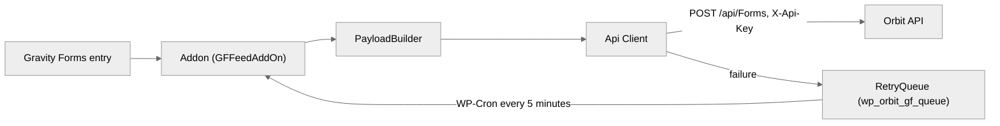

# Developer guide

How the plugin is built, how to test it locally and how to release it.

## Architecture



| Path | Responsibility |
| --- | --- |
| `orbit-gravity-forms.php` | Plugin header, constants, PSR-4 autoloader (no vendor directory ships) |
| `src/Plugin.php` | Wires everything to WordPress; activation creates the queue table and cron event |
| `src/Addon.php` | The Gravity Forms feed add-on: feed settings, sending, entry box |
| `src/Connections.php` | Named Orbit API keys, encrypted in the `orbit_gf_connections` option (not autoloaded) |
| `src/Api/Client.php` | HTTP to Orbit; caches form types, sources and categories for 10 minutes per account |
| `src/Api/ErrorMessage.php` | Plain-words errors from Orbit's problem details; decides what is retryable |
| `src/Mapping/` | Pure logic with no WordPress calls: slot names, contact fields, value conversion, payload |
| `src/Queue/RetryQueue.php` | Failed sends, back-off and the retry cron job |
| `src/Admin/` | Forms, Orbit accounts and Forms, Orbit queue screens |
| `src/Migration/LegacyImporter.php` | Turns KulaHub plugin settings into a feed |
| `src/Support/` | Secret encryption, Gravity Forms capability checks and the GitHub updater |

## The Orbit request

The plugin calls `POST /api/Forms` (a documented consumer endpoint) with the API key in `X-Api-Key`:

```json
{
  "formTypeId": 42,
  "sourceId": 7,
  "Text1": "Brochure",
  "Money2": 1000,
  "Bit1": true,
  "DateTime1": "2026-12-01T00:00:00",
  "contact": {
    "email": "jane@example.com",
    "firstName": "Jane",
    "emailSubscribe": true,
    "categoryIds": [3],
    "sourceId": 7
  }
}
```

Orbit names a form type's custom fields by slot: `Text1`–`Text50`, `DateTime1`–`DateTime25`, `Money1`–`Money15`, `Bit1`–`Bit9`, `Number1`–`Number10` and `IntegerLong1`–`IntegerLong3`. The database (and the KulaHub plugin) calls them `varchar1`, `datetime1`, `money1`, `bit1` and `number1`; `Mapping\Columns::normalise()` accepts both. The feed's field list comes from `GET /api/FormTypes`, reading each field's `customFieldTableColumnName` and falling back to `dataColumnV2` for fields created in V2.

Behaviour that lives in Orbit, not the plugin:

- A contact is matched by email (then name and postcode, then organisation). When one matches, the form is attached to it and the contact's stored details are kept; the submitted details do not overwrite them, and the submitted opt-in does not change their subscription.
- A new contact without an opt-in is stored as unsubscribed.
- When the Orbit account requires a category, a request without `categoryIds` is refused.
- Known Orbit bug (found 23 November 2026): when the contact already exists and already has one of the `categoryIds`, Orbit answers HTTP 500. `CreateEditContactHandler` adds `ContactCategory` rows to the matched contact without loading its existing ones, so the insert breaks the primary key. The plugin treats a 500 as temporary and retries, which cannot succeed until Orbit is fixed.
- Gravity Forms gives administrators `gform_full_access` rather than each `gravityforms_*` capability, so permission checks go through `Support\Capabilities`, never `current_user_can()` directly.

## Hooks

| Hook | Type | Use |
| --- | --- | --- |
| `orbit_gf_payload` | filter | Change the request body: `( array $payload, array $feed, array $entry, array $form )` |
| `orbit_gf_sent` | action | Runs after Orbit creates the form: `( array $orbit_form, array $feed, array $entry, array $form )` |
| `orbit_gf_api_url` | filter | Change the API base URL |

## Local test site

`dev/docker-compose.yml` runs WordPress on <http://localhost:8090> (OrbStack or Docker Desktop) with this folder mounted as the plugin, pointed at Orbit's local API (`https://host.docker.internal:3122`, certificate checks off).

```bash
docker compose -f dev/docker-compose.yml up -d
alias wpd='docker compose -f dev/docker-compose.yml run --rm -T cli wp'
wpd core install --url=http://localhost:8090 --title="Orbit GF Test" --admin_user=admin --admin_password=admin --admin_email=admin@example.test --skip-email
# Gravity Forms is paid: put its zip in dev/zips/ (gitignored), then
wpd plugin install /zips/gravityforms.zip --activate
wpd plugin activate orbit-gravity-forms
```

Apache also listens on 8090 inside the container (`dev/listen-8090.conf`), because Gravity Forms sends feeds through a background request to the site's own URL.

`dev/scripts/seed-forms.php <connection-id>` creates three test forms with feeds (a contact form, a pipeline form with money and date fields, and a form set up the KulaHub plugin's way), and a page showing them. `dev/scripts/orbit-get.php /api/Forms/<id>` reads a result back from Orbit with the stored key.

Orbit's local API uses the production database, so anything submitted creates real records. Use a test account, addresses at `@<something>.test` (a reserved domain that never delivers mail; Gravity Forms refuses `example.com`), and remove what you create.

## Tests and checks

```bash
composer install
composer preflight      # composer validate, PHPCS (WordPress-Extra, Docs, PHPCompatibilityWP), PHPUnit
```

Unit tests cover the pure mapping, conversion, encryption, error and import logic with Brain Monkey. The Gravity Forms integration is tested end to end against the local site.

## Releasing

1. Update the version in `orbit-gravity-forms.php` (header and `ORBIT_GF_VERSION`), `readme.txt` (`Stable tag` and changelog) and `CHANGELOG.md`.
2. Commit, then tag: `git tag v1.0.1 && git push --tags`.
3. The release workflow builds `orbit-gravity-forms.zip` (top folder `orbit-gravity-forms/`, no dev files) and attaches it to a GitHub release. Sites with `ORBIT_GF_GITHUB_TOKEN` see the update within six hours.
